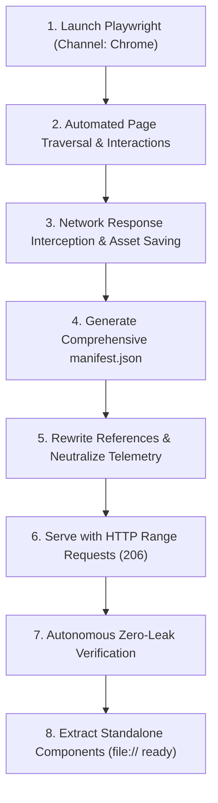

# Website Duplicator: Autonomous Web & WebGL Mirroring System

This skill provides an end-to-end autonomous runbook and toolkit for capturing, rewriting, rebuilding, and verifying modern websites—with specialized support for complex WebGL/Three.js 3D applications, WebAssembly transcoders, streaming media, and Single Page Application (SPA) routers.

---

## 🎯 When to Use This Skill

- **Full Website Duplication**: Cloning an entire production site for local offline playback with zero leaks to the original host.
- **Interactive WebGL & Three.js Archival**: Capturing runtime-generated shaders, Draco compressed geometries, KTX2 textures, and WebAssembly decoders that simple scrapers (`wget`, `curl`) miss.
- **Component & 3D Effect Extraction**: Extracting standalone 3D models, shaders, and UI components into reusable, self-contained single-file HTML templates with `file:///` protocol compatibility.
- **Offline Preservation & Verification**: Verifying that mirrored applications execute without 404 errors, network leaks, or missing assets.

---

## 🏗 Core Workflow



---

## 📋 Step-by-Step Instructions

### Step 1: Initialize Project & Dependencies
Create a dedicated project directory with required dependencies:
```bash
npm init -y
npm install playwright
```

### Step 2: Runtime Network Capture with Playwright
Standard web scrapers fail on modern JavaScript and WebGL apps because critical assets (3D meshes, textures, shaders, transcoders) are requested dynamically at runtime by WebAssembly and WebGL engines.

Run the automated capture bot:
- **Browser Launch**: Always specify `{ channel: 'chrome', headless: false }` or headless mode on Windows to leverage the installed system Chrome.
- **Network Interception**: Intercept every response via `page.on('response', ...)`:
  - Save binary buffers (`response.body()`) directly to disk.
  - Preserve exact URL directory structures for same-origin and external CDN hosts (`_external/<hostname>/...`).
  - Capture all MIME types: WebAssembly (`.wasm`), Draco (`.drc`, `.bin`), KTX2 (`.ktx2`), GLTF/GLB, MP4 streaming video, MP3 audio, shaders (`.vs`, `.fs`, `.glsl`), JSON, fonts (`.woff2`, `.otf`), images, and bundles.
- **Target**: Pass the site with `--url https://example.com`. Each run copies only that URL.
- **Automated Interaction**:
  - Programmatically scroll the entire height of the document with smooth increments.
  - Dispatch mouse movements and gestures across the page to trigger hover states, shaders, and dynamic loader queues.
  - Visit same-origin routes discovered from anchors and `data-route` / `data-path` / `data-href`. Pass extra client-side routes with `--routes /pricing,/docs` when the DOM does not expose them.
- **Manifest Generation**: Record every captured response into `manifest.json` with original URL, MIME type, HTTP status, and local disk path.

### Step 3: Reference Rewriting & Telemetry Neutralization
Once assets are captured, post-process all HTML, JavaScript, and CSS files:
1. **Host Replacement**: Rewrite the captured site origin to root-relative paths, and rewrite every third-party host saved under `mirror/_external/<host>/` to that local prefix. Hosts come from `--url` and from the capture.
2. **Telemetry Neutralization**: Disable Google Tag Manager, Google Analytics, Sentry, and Facebook Pixel trackers to prevent console spam and outbound leaks.
3. **API & Dynamic Route Fallbacks**: Ensure client-side SPA routing (`history.pushState`) resolves gracefully.

### Step 4: Local Streaming Server (HTTP 206 Support)
Modern WebGL applications stream MP4 videos and large audio files using HTTP `Range` requests (`bytes=0-`). A basic web server will fail, causing infinite loading spinners:
- **Range Headers**: Implement `206 Partial Content` streaming for video/audio.
- **SPA Fallback**: Route unknown routes back to `index.html`.
- **EADDRINUSE Protection**: Automatically increment the port if the default port (e.g., 8080) is occupied.

### Step 5: Autonomous Verification Suite
Verify the rebuilt site autonomously:
1. Launch Chromium in headless mode pointed at the local server.
2. Monitor all outbound requests to confirm:
   - **0 requests to the original host** (`[PASS]`).
   - **0 requests to other third-party hosts** (`[PASS]`).
   - **0 HTTP 404 Not Found errors** (`[PASS]`).
   - When the source page renders a canvas, a `<canvas>` element is present.
3. Screenshot the mirrored pages and the live site. Paths come from links on the page, or from `--paths`.

### Step 6: Standalone Component Extraction (`file:///` Ready)
When extracting an isolated 3D component (a model, texture set, or particle system) into a single reusable HTML file:
- **Avoid CORS Traps**: Modern browsers block `fetch()` and `Image()` on local disk (`file:///`) URLs.
- **Data URIs**: Convert extracted textures (normals, matcaps, diffuse maps) to base64 Data URIs (`data:image/jpeg;base64,...`) or script-embedded globals.
- **Decode Binary Geometries**: If a `.bin` payload has a header before the Draco stream, cut at the `DRACO` magic bytes and save a clean `.drc` file.

---

## 🛠 Included Tool Scripts

The `scripts/` directory in this skill package includes ready-to-run implementations. Every site-specific value is an argument.

```bash
node scripts/capture.js --url https://example.com
node scripts/rewrite.js --url https://example.com
node scripts/serve.js
node scripts/verify.js --url https://example.com
```

- [`scripts/capture.js`](./scripts/capture.js): Automated Playwright crawler, response interceptor, and interaction bot.
- [`scripts/rewrite.js`](./scripts/rewrite.js): Rewrites the captured origin and any host stored under `_external/`, and neutralizes common telemetry.
- [`scripts/serve.js`](./scripts/serve.js): HTTP server with Range streaming and SPA routing.
- [`scripts/verify.js`](./scripts/verify.js): Headless test runner testing for zero leaks and render integrity.
- [`scripts/decode_geometry.js`](./scripts/decode_geometry.js): Draco mesh decoder. Finds the `DRACO` magic bytes and writes a clean `.drc` payload.
