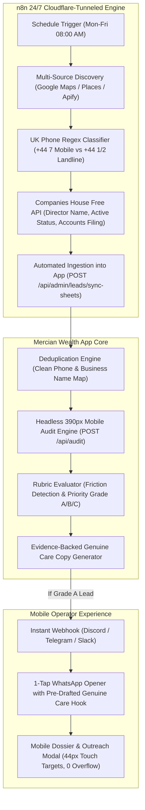

# Autonomous n8n Lead Finder & Mobile-First Outreach Optimization Architecture
## Production Implementation Plan & System Specification

> **Mission Objective:** Seamlessly connect self-hosted n8n automation with the Mercian Wealth acquisition application to autonomously discover, enrich (via UK Companies House), pre-qualify, and forensically audit prospective accounting and professional practices at a 390px mobile viewport, while guaranteeing **zero mobile optimization errors** and touch-perfect responsiveness for operators on phones.

---

## 1. Executive Architecture Overview

---

## 2. Deep Dive: n8n Deployment Script Analysis

### Script 1: `deploy_n8n_script.md` (`deploy_n8n.py`)
- **Core Function:** A Python DevOps automation script utilizing the official Cloudflare v4 REST API and Docker Compose.
- **Key Operations:**
  1. Authenticates via dedicated Account and DNS Bearer tokens.
  2. Dynamically queries Cloudflare Account ID and Zone ID for the targeted domain.
  3. Provisions a cryptographically secured Cloudflare Named Tunnel (`cfd_tunnel`) with a 32-byte secret.
  4. Configures tunnel remote ingress rules routing `<subdomain>.<domain>` directly to Docker internal port `n8n:5678`.
  5. Points a proxied DNS CNAME (`proxied: true`) to the tunnel target, providing edge SSL termination with zero local certificate management.
  6. Automatically spins up persistent n8n and cloudflared containers via `docker compose up -d`.
- **Target Persona:** Engineers, system administrators, and CI/CD pipelines needing headless, idempotent server setup.

### Script 2: `n8n_ai_student_prompt.md`
- **Core Function:** An autonomous behavioral prompt for AI coding agents (Antigravity, Cursor, Codex, ChatGPT).
- **Key Operations:**
  1. Enforces 100% autonomous execution without demanding command-line actions from the user.
  2. Validates prerequisite dependencies (Python, `requests` library, and Docker Desktop status).
  3. Automatically populates, writes, and executes `deploy_n8n.py`.
  4. Monitors container startup via `docker ps` and returns a live HTTPS URL upon completion.
- **Target Persona:** Students and non-technical founders in AI Automation campuses (The Real World / Campus) eliminating the 80%+ drop-off rate traditionally caused by local server networking setup.

---

## 3. Lead Finder Optimization Strategy

### 3.1. Automated UK Companies House Enrichment
- **The Gap:** Google Maps scraping provides only generic trade names and office numbers, forcing outreach to open with generic greetings ("Hi team").
- **The Solution:** The official UK Companies House API (`https://api.company-information.service.gov.uk`) is completely free and provides:
  1. **Active Officers / Directors:** True decision-maker full names (e.g., *"Kirit Rathod"*, *"Barrie Ingram"*).
  2. **Company Filing Deadlines:** Exact next accounts due date and confirmation statement cut-off, allowing outreach copy to reference real statutory timelines.
  3. **Company Registration Number:** Hard regulatory proof embedded into lead metadata.

### 3.2. Automated Pre-Qualification & Channel Routing
Before consuming audit or AI resources, leads are pre-filtered inside n8n:
- **UK Mobile (`+44 7...`):** Flagged as `WhatsApp-viable` (routes to 1-Touch / 3-Step WhatsApp workflows).
- **UK Landline (`+44 1...` / `+44 2...`):** Flagged as `Landline Only` (automatically switches default channel to Email / Direct Call, preventing wasted WhatsApp messages).
- **Website Status:** If no website is listed or the domain returns 404/holding, immediately tagged with the `No Website / Word-of-Mouth` referral playbook.

### 3.3. Dual-Auth Headless Audit API
- `/api/audit` now supports dual authentication:
  1. **Browser User Session:** Next.js Supabase cookie auth for admin UI users.
  2. **Service Header Auth:** `Authorization: Bearer <SUPABASE_SERVICE_ROLE_KEY>` or `x-api-key: <KEY>` allowing background n8n instances to trigger headless audits without browser cookies.

---

## 4. Mobile Ergonomics & Zero-Error Viewport Optimization

To ensure operators can run outreach sprints from an iPhone, iPad, or Android phone without friction, the following mobile UI standards have been coded across all components:

| Area | Desktop Behavior | Mobile Optimization Implemented |
| :--- | :--- | :--- |
| **Modal Viewport** | `max-h-[92vh]` | `max-h-[96dvh] sm:max-h-[92vh]` with `overscroll-contain` to prevent iOS background scrolling |
| **Touch Targets** | `px-2.5 py-1` (~28px) | Minimum 40px–44px touch targets (`min-h-[40px]`, `min-h-[42px]`) for finger tapping |
| **Header Controls** | Text + icon alongside title | Icon-primary with responsive text hiding (`hidden sm:inline`) to prevent title clipping |
| **Action Buttons** | Horizontal button chain | Responsive 2-column grid (`grid grid-cols-2 sm:flex`) with active scale feedback (`active:scale-98`) |
| **Horizontal Scrolling** | Hidden scrollbars | Inertia-scrolling with `touch-pan-x` and comfortable button padding (`px-3.5 py-2`) |

---

## 5. Deployment & Workflow Import Instructions

### Which File to Import into n8n:
- **Import File:** [`public/n8n_autonomous_lead_finder_workflow.json`](file:///c:/Users/Deepg/OneDrive/Desktop/The%20Real%20World/Campuses/AI%20Automation/New%20Lessons/CODING/v0-gs-legacy-wealth-app/public/n8n_autonomous_lead_finder_workflow.json)
- **How to Import in n8n:**
  1. Open your live n8n instance (e.g. `https://n8n.yourdomain.com`).
  2. Click **Workflows** in the left sidebar.
  3. Click the **`...`** menu in the top right corner and select **Import from File**.
  4. Select `public/n8n_autonomous_lead_finder_workflow.json`.
  5. In Node **1. Configuration & Secrets**, set:
     - `PLATFORM_URL`: Your deployed Mercian Wealth URL (or `http://localhost:3000`).
     - `SUPABASE_SERVICE_ROLE_KEY`: Your Supabase Service Role Secret Key.
     - `DISCORD_OR_SLACK_WEBHOOK_URL`: (Optional) Your alert channel webhook.
  6. Click **Save** and toggle the workflow to **Active**.
