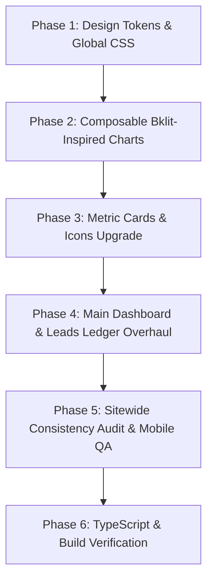

# Master Implementation Plan: Admin Dashboard Repositioning, Motion.dev Design System & Outreach Graphics Overhaul

**Mercian Wealth · Enterprise Operations Platform**  
**Document Reference:** `Implementation/Admin dashboard/REPOSITIONING_AND_DESIGN_SYSTEM_OVERHAUL_PLAN.md`  
**Standardized Architecture:** Motion.dev + Radix UI Primitives + Lucide Icons + Composable Bklit-Inspired Charts  
**Design Philosophy:** Outcome Over Tool, Always (`POSITIONING_PRINCIPLES.md`)  

---

## 1. Executive Summary & Review Synthesis

Following thorough peer reviews by **G** and **Cedric**, the admin dashboard is undergoing a complete architectural repositioning to eradicate all traces of "vibecoded" inconsistency, arbitrary colors, decorative bloat, and mismatched component libraries.

### Key Critique Items Addressed:
1. **Single Committed UI Ecosystem**: Double down exclusively on **Motion.dev (`https://motion.dev/`)** integrated with **Radix UI Primitives**, **Tailwind CSS**, and **Lucide React**. Eliminate all conflicting styles or ad-hoc design patterns.
2. **Proper Color Palette (Obsidian & Motion Gold)**: Purge all arbitrary, random colors and rainbow gradients. Standardize sitewide on an Obsidian Carbon dark foundation (`#050505` canvas, `#0B0B0D` surface, `#141417` elevated) accented with a single refined **Motion Gold** (`#DAA640`) and strict 6px semantic indicator dots (Emerald for Won/Active, Amber for In-Flight, Rose for Lost/Spam).
3. **Card-Only Elevation & Specular Inner Shadows**: Add tactical drop shadows and subtle specular inner highlight borders (`inset 0 1px 0 0 rgba(255,255,255,0.08)`) to cards and panels only, avoiding shadow pollution on buttons, badges, inputs, or text.
4. **Metric Cards with Purposeful Icons (Rexora Benchmark)**: Upgrade all KPI cards from bare numbers to structured metric containers featuring dedicated Lucide icons, trend micro-indicators (+X% vs last period), and clean typography.
5. **Purge of Eyebrow Clutter & Bloat Pills**: Permanently remove the decorative orange eyebrow text (`✦ LOCAL BUSINESS OUTREACH ENGINE`, `✦ OPERATIONS CONSOLE`), strip out all occurrences of "cockpit", and remove gimmicky emoji badges.
6. **High-Signal Outreach Graphics (bklit.com Benchmark)**: Integrate two clean, executive-grade data visualizations into the main dashboard:
   - **Outreach Conversion Funnel Chart**: A multi-stage pipeline flow (Fresh Leads → Contacted → Call Booked → Proposal Sent → Won Deals) with subtle layered halos and entrance animations.
   - **Outreach Velocity & Financial Trajectory Area Chart**: A dual-curve smooth area chart with gradient fills, subtle grid lines, and an interactive hover scrubber displaying outreach volume against pipeline value.
7. **Strict 8px Mathematical Rem Grid**: Lock all margins, paddings, gaps, and heights into multiples of `0.5rem` (8px), eliminating arbitrary tailwind classes (`py-0.2`, `p-2.5`, `px-3.5`).
8. **Full-Stack & Mobile Integrity**: Ensure total parity between frontend state and Supabase backend schemas, real-time channels, and seamless responsiveness across desktop, tablet, and mobile devices.

---

## 2. Design Token System: Obsidian, Carbon & Motion Gold

### A. Core Color Tokens (`app/globals.css`)
```css
:root {
  /* Canvas & Surfaces */
  --canvas-base: #050505;          /* Deep Matte Obsidian Canvas */
  --surface-card: #0B0B0D;         /* Solid Carbon Zinc Card Surface */
  --surface-elevated: #141417;     /* Elevated Modals, Dropdowns, Toolbars */
  --surface-hover: #1A1A20;        /* Hover States & Active Toggles */

  /* Borders & Specular Highlights */
  --border-surgical: rgba(255, 255, 255, 0.08); /* 1px High-Precision Neutral Border */
  --border-subtle: rgba(255, 255, 255, 0.04);   /* Subtle Interior Dividers */
  --border-highlight: rgba(255, 255, 255, 0.16); /* Hover Border Accent */

  /* Brand Accents */
  --brand-gold: #DAA640;           /* Motion Electric Gold */
  --brand-gold-glow: rgba(218, 166, 64, 0.15);
  --brand-gold-muted: rgba(218, 166, 64, 0.25);

  /* Strict Semantic Signals (6px Dots & Subtle Accents Only) */
  --semantic-emerald: #10B981;     /* Won, Active, Healthy, Verified */
  --semantic-emerald-bg: rgba(16, 185, 129, 0.08);
  --semantic-amber: #F59E0B;       /* In-Progress, Due Follow-Up, Scheduled */
  --semantic-amber-bg: rgba(245, 158, 11, 0.08);
  --semantic-rose: #EF4444;        /* Lost, Disqualified, Overdue */
  --semantic-rose-bg: rgba(239, 68, 68, 0.08);
  --semantic-zinc: #71717A;        /* Archived, Neutral, Cold */

  /* Typography */
  --text-primary: #FFFFFF;         /* Crisp High-Contrast Headlines & Primary Metrics */
  --text-secondary: #A1A1AA;       /* Zinc-400 Neutral Labels, Metadata, Telephony */
  --text-muted: #71717A;           /* Zinc-500 Captions & Inactive Statuses */
}
```

### B. Card-Only Shadow & Specular Inner Highlight
To fulfill G's specific recommendation (*"start adding shadow/inner shadows to the cards, don't let it add it to other elements"*), we define a dedicated card elevation utility:

```css
@layer utilities {
  /* Executive Card Elevation: Soft Ambient Drop + Crisp Specular Top Highlight */
  .card-depth {
    background-color: var(--surface-card);
    border: 1px solid var(--border-surgical);
    box-shadow: 
      0 10px 25px -5px rgba(0, 0, 0, 0.6),
      0 4px 6px -2px rgba(0, 0, 0, 0.4),
      inset 0 1px 0 0 rgba(255, 255, 255, 0.08),
      inset 0 -1px 0 0 rgba(0, 0, 0, 0.4);
    border-radius: 1rem; /* 16px */
    transition: all 0.25s cubic-bezier(0.16, 1, 0.3, 1);
  }

  .card-depth:hover {
    border-color: var(--border-highlight);
    box-shadow: 
      0 14px 35px -4px rgba(0, 0, 0, 0.75),
      0 6px 12px -2px rgba(0, 0, 0, 0.5),
      inset 0 1px 0 0 rgba(255, 255, 255, 0.14),
      inset 0 -1px 0 0 rgba(0, 0, 0, 0.4);
  }

  /* Active Card Selection (e.g. Filtered KPI card) */
  .card-depth-active {
    border-color: var(--brand-gold);
    box-shadow: 
      0 10px 25px -5px rgba(0, 0, 0, 0.6),
      0 0 0 1px var(--brand-gold),
      inset 0 1px 0 0 rgba(255, 255, 255, 0.15);
  }
}
```

### C. Mathematical 8px Spacing Grid (Rem System)
Eradicate fractional arbitrary values (`py-0.2`, `p-2.5`, `px-3.5`). Enforce strict multiples of `0.5rem`:
- **`0.25rem` (4px)**: Micro spacing between icons and text labels (`gap-1`).
- **`0.5rem` (8px)**: Compact padding, button spacing, badge insets (`p-2`, `gap-2`).
- **`1rem` (16px)**: Standard card interior padding, input heights, toolbar gaps (`p-4`, `gap-4`).
- **`1.5rem` (24px)**: Grid column gaps, modal body padding, section dividers (`p-6`, `gap-6`).
- **`2rem` (32px)**: Section spacing, main layout vertical separation (`space-y-8`, `p-8`).
- **`2.5rem` (40px)**: Major screen chunking and hero transitions.

---

## 3. Metric Cards Transformation (Rexora Benchmark)

In accordance with G's review and the Rexora reference design, all metric blocks will feature:
1. **Dedicated Lucide Icon Badge**: Placed on the top-right in a circular/rounded elevated container (`w-8 h-8 rounded-xl bg-white/5 border border-white/10 flex items-center justify-center`).
2. **Clear Label & Status Indicator**: Uppercase monospace label (`text-[11px] font-mono uppercase tracking-wider text-zinc-400`) paired with a minimal 6px semantic dot.
3. **Primary Metric Display**: Large high-contrast tabular figures (`text-2xl font-bold text-white font-sans`).
4. **Trend / Context Subtext**: Micro-trend badge (`+4.2% vs last week` or `Active Inbound`) with clickable quick-action affordance.
5. **Inner Shadow & Card Depth**: Encapsulated within `.card-depth`.

### Metric Icon Mapping:
| Metric Card | Lucide Icon | Icon Styling | Dot Color |
| :--- | :--- | :--- | :--- |
| **Fresh Leads** | `Inbox` | `text-zinc-300 bg-white/5` | `bg-zinc-400` |
| **Contacted** | `MessageSquare` | `text-amber-400 bg-amber-400/10` | `bg-amber-400` |
| **Call Booked** | `Calendar` | `text-amber-400 bg-amber-400/10` | `bg-amber-400` |
| **Proposal Sent** | `Send` / `FileText` | `text-amber-400 bg-amber-400/10` | `bg-amber-400` |
| **Won Deals** | `Trophy` / `CheckCircle2` | `text-emerald-400 bg-emerald-400/10` | `bg-emerald-400` |
| **Lost** | `XCircle` / `TrendingDown` | `text-rose-400 bg-rose-400/10` | `bg-rose-500` |
| **Total Sales** | `PoundSterling` | `text-[#DAA640] bg-[#DAA640]/10` | `bg-emerald-400` |
| **Pipeline Value** | `FolderKanban` | `text-[#DAA640] bg-[#DAA640]/10` | `bg-[#DAA640]` |
| **Monthly MRR** | `TrendingUp` | `text-[#DAA640] bg-[#DAA640]/10` | `bg-[#DAA640]` |

---

## 4. Outreach Visual Graphics (bklit.com Benchmark)

To illustrate the current state of outreach with executive clarity without adding visual noise or cognitive overload, two purposeful charts will be introduced:

### Chart 1: Outreach Pipeline Conversion Funnel (`@/components/admin/charts/outreach-funnel-chart.tsx`)
Inspired by the **bklit Funnel Chart**:
- **Purpose**: Visualizes the conversion efficiency across the 5 primary sales stages:
  1. `Fresh Leads` (100% baseline)
  2. `Contacted` (WhatsApp / Direct)
  3. `Call Booked` (Strategy Sessions)
  4. `Proposal Sent` (Tiered Solutions)
  5. `Won / Closed` (Contract Signed & Paid)
- **Visual Design**:
  - Horizontal or staged trapezoid funnel with animated SVG paths and staggered entrance via Framer Motion.
  - Multi-layer halo rings and smooth gradient fills (`#DAA640` gold gradient fading into deep carbon).
  - Stage count, conversion percentage between adjacent steps, and drop-off rate displayed cleanly.
  - Hover interaction highlights the active funnel tier and shows detailed metrics in a floating tooltip.

### Chart 2: Outreach Velocity & Pipeline Value Area Chart (`@/components/admin/charts/outreach-area-chart.tsx`)
Inspired by the **bklit Area Chart**:
- **Purpose**: Tracks weekly outreach momentum against resulting pipeline value over 8 to 12 rolling weeks.
- **Visual Design**:
  - Dual composable wave lines:
    - Primary Wave (Gold gradient fill): Weekly Outreach Actions.
    - Secondary Wave (Emerald/Zinc gradient fill): Qualified Pipeline Generated (£).
  - Smooth Bézier curve interpolation with responsive SVG canvas.
  - Interactive vertical scrubber line that follows cursor/touch:
    - Floating pill badge indicating the date/week.
    - Floating glass card displaying exact counts and revenue with dot indicators.
  - Minimal horizontal grid lines (`stroke-white/5`) without cluttering the canvas.

---

## 5. Screen-by-Screen Overhaul Plan

### A. Admin Main Dashboard (`app/(admin)/admin/page.tsx`)
1. **Purge Eyebrow & Clutter**: Remove `<div className="... uppercase"> <Sparkles /> Operations Console </div>` and any "cockpit" references.
2. **Page Header**: Clean typography hierarchy:
   - H1: **Operations Terminal**
   - Subtitle: *Live outreach velocity, conversion telemetry, and revenue pipeline.*
   - Action: `View Public Site` (clean text + arrow, no glowing button).
3. **KPI Row (`AdminKpiRow`)**:
   - Upgrade the 6 metric blocks to `.card-depth` with top-right Lucide icons (`PoundSterling`, `FolderKanban`, `Inbox`, `Calendar`, `TrendingUp`).
   - Add trend badges (`+8.4% vs last mo`, `3 active bookings today`).
4. **Outreach Graphics Section**:
   - Insert a two-column or split grid above the client health feed:
     - Left (60%): **Outreach & Pipeline Value Trajectory Area Chart**.
     - Right (40%): **Stage-by-Stage Conversion Funnel**.
   - Encapsulated in `.card-depth` with an 8px spacing grid.
5. **Operational Grids**:
   - `ClientHealthGrid`, `AttentionPanel`, and `TransactionsFeed` wrapped in `.card-depth`.
   - Table rows and action items standardized to 8px padding (`p-4`, `gap-3`).

### B. Lead Outreach Ledger (`app/(admin)/admin/leads/page.tsx`)
1. **Purge Eyebrow**: Delete `<div className="... uppercase"> <Sparkles /> Local Business Outreach Engine </div>`.
2. **Page Header**:
   - H1: **Lead Outreach Ledger**
   - Subhead: *Verified WhatsApp outreach, digital storefront prototypes, and deal closing.*
   - CTAs: `Sync Sheet` (Google Sheets 2-way sync) and `+ Add Lead` (Motion Gold).
3. **Motion Stats Grid**:
   - Add icons to all 6 status buttons:
     - Fresh Leads (`Inbox`), Contacted (`MessageSquare`), Call Booked (`Calendar`), Proposal Sent (`Send`), Won Deals (`Trophy`), Lost (`XCircle`).
   - Wrap each button in `.card-depth`.
   - Active filter applies `.card-depth-active` with subtle gold ring.
4. **Motion Sliding Segmented Filter**:
   - Maintain the fluid Framer Motion slider (`layoutId="activeSegment"`).
   - Segments: `All Leads`, `No Website`, `WhatsApp Ready`, `Landlines`, `Has Website`.
   - Remove any leftover emojis; use clean numeric badges.
5. **Lead Cards Grid (`viewMode === 'cards'`)**:
   - Wrap cards in `.card-depth`.
   - Card Header: High-contrast title, trade badge, clean star rating (`★ 5.0 (120)`).
   - Card Body: Clean metadata row (Phone with mobile/landline indicator, verified address, website status).
   - Card Action Strip:
     - Primary: **WhatsApp** (`bg-white hover:bg-zinc-200 text-black font-semibold`).
     - Secondary: **Pitch Demo** (`border border-white/10 hover:bg-white/5 text-zinc-300`).
     - Overflow: `···` dropdown for Stage Changes, Inspect, and Archive.
     - *Zero bloat, zero 6-button clutters.*

### C. Bookings & Sessions (`app/(admin)/admin/bookings/page.tsx`)
- Standardize all session cards to `.card-depth`.
- Replace colored pills with 6px semantic dots.
- Align date and time pickers with the 8px rem grid.

### D. Invoices & Quotes (`app/(admin)/admin/quotes/page.tsx`)
- Standardize invoice cards and tables with `.card-depth`.
- Ensure mobile layout renders touch-friendly cards while desktop displays high-density rows.
- Monetary figures styled with `font-sans font-bold text-white`.

### E. Client Health & Directory (`app/(admin)/admin/clients/page.tsx`)
- Clean executive health indicators: Response Velocity (hours), Active Action Requests, Contract Value.
- Eliminate decorative badges in favor of verified metric cards.

### F. Global Navigation & Sidebar (`components/admin/sidebar.tsx`)
- Verify 8px rem spacing (`px-4`, `py-2`, `gap-2`).
- Active link marked by subtle gold left border or background tint (`bg-white/5 text-white border-l-2 border-[#DAA640]`).
- Clean mobile drawer slide with smooth spring physics (`stiffness: 300, damping: 30`).

---

## 6. Backend & Data Architecture Parity

1. **Supabase Real-Time Subscriptions**:
   - Ensure the lead outreach ledger and main dashboard subscribe to `postgres_changes` on `leads`, `strategy_sessions`, and `projects`.
   - Optimistic UI updates remain instant (0ms latency), falling back to server state on network errors.
2. **Google Sheets 2-Way Sync Webhook**:
   - Maintain seamless synchronization with the Google Apps Script webhook for additions, edits, and deletions.
3. **Data Types & RPCs**:
   - Funnel data computed dynamically from active lead counts across `status` groups (`New`, `Contacted`, `Call Booked`, `Proposal Sent`, `Won`).
   - Area chart telemetry derived from weekly timestamps on `activity_logs` and `payments`.
   - Zero hardcoded mock numbers that disconnect from database reality.

---

## 7. Mobile Ergonomics & Responsive Architecture

- **Viewport Safety**: `max-width: 100%`, `overflow-x: hidden`, zero horizontal layout breaks.
- **Touch-First Hit Targets**: All buttons, dropdown items, and toggles have a minimum height of `44px` (`h-11`) or minimum padding of `0.75rem`.
- **Card Stacking**:
  - Desktop: 3-column grid (`grid-cols-1 md:grid-cols-2 xl:grid-cols-3`).
  - Tablet: 2-column grid.
  - Mobile: Single-column clean stack with bottom sheet modals for actions.
- **Chart Responsiveness**:
  - Area and Funnel charts wrap dynamically using responsive SVG viewBoxes and touch-scrubbing listeners.

---

## 8. Implementation Phases & Deliverables



### Phase 1: Design Tokens & Global CSS
- Update `app/globals.css` with `.card-depth`, `.card-depth-active`, obsidian palette tokens, and 8px rem grid utilities.
- Confirm dark mode consistency and remove conflicting shadow rules.

### Phase 2: Composable Bklit-Inspired Charts
- Build `components/admin/charts/outreach-funnel-chart.tsx` (animated SVG conversion funnel).
- Build `components/admin/charts/outreach-area-chart.tsx` (smooth dual-wave area chart with hover scrubber).
- Verify pure client-side rendering with motion and responsive SVG viewBox.

### Phase 3: Metric Cards & Icons Upgrade
- Refactor `components/admin/kpi-row.tsx` to include dedicated Lucide icons, trend badges, and `.card-depth`.
- Update the 6 status metric buttons in `app/(admin)/admin/leads/page.tsx` with dedicated Lucide icons.

### Phase 4: Main Dashboard & Leads Ledger Overhaul
- Strip all orange eyebrow text and "cockpit" references from `app/(admin)/admin/page.tsx` and `app/(admin)/admin/leads/page.tsx`.
- Embed the new Funnel and Area charts on `app/(admin)/admin/page.tsx`.
- Ensure lead cards in `leads/page.tsx` utilize `.card-depth` and the 2-button action strip.

### Phase 5: Sitewide Consistency Audit & Mobile QA
- Audit `bookings`, `quotes`, `projects`, `clients`, `settings`, and `notifications`.
- Test on mobile (375px, 390px, 414px) and desktop (1440px, 1920px) to ensure zero overflow and smooth interactions.

### Phase 6: TypeScript & Build Verification
- Execute `npm run build` / typecheck to confirm zero syntax errors, missing imports, or type regressions.

---

*Plan formulated in strict adherence to `POSITIONING_PRINCIPLES.md` and user peer review specifications.*
