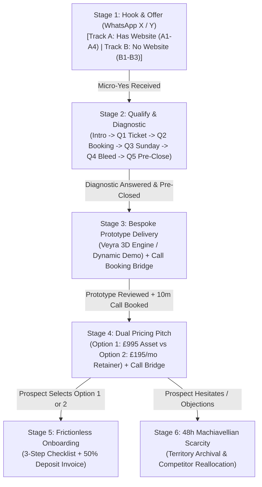

# 🏛️ Mercian Wealth — High-Ticket Acquisition Playbook & Outreach Engine

**System:** Admin Outreach Cockpit & Consultative Client Acquisition Pipeline  
**Target:** Local Trade Contractors, Luxury Bespoke Jewellers / Diamond Ateliers, Private Clinics, High-End Service Businesses  
**Path:** `components/admin/outreach-modal.tsx`  
**Status:** Active & Production Ready  

---

## 1. Executive Summary & Strategic Architecture

The **Mercian Wealth High-Ticket Acquisition Engine** is a high-status, consultative sales architecture designed to transition cold or inbound local business leads into high-margin clients without sounding like a transactional web designer or software vendor.

### Core Sales Axioms & WhatsApp Translation (From Outreach Engine Modules 1 & 2)
1. **Sell the Outcome, Never the Tool:**  
   Never mention code, React, Next.js, WordPress, or design plugins. Talk exclusively about **speed-to-lead**, **capturing evening mobile searches**, **eliminating no-shows via holding deposits**, and **stopping leads leaking to competitors**.
2. **The Unit Economics Anchor:**  
   Always demonstrate that **1 single customer order/job** completely pays off the entire build fee. Everything after that is pure profit.
3. **Accuracy Over Personalization (Module 2):**  
   Never include fake metrics ("I saw you had 1,400 visitors") or generic flattery ("Love your inspiring feed"). Focus on 1 observable, decision-tied friction point on 1 specific page.
4. **Never Ask for a Call in Message 1 (Module 2):**  
   WhatsApp Message 1 has exactly ONE job: get the **Micro-Yes** (permission to send free value). Asking for a 15-minute call in message 1 triggers the prospect's "sales pitch trap" filter and burns the lead.
5. **The Call Booking Bridge (Stage 3/4):**  
   Calls are booked *after* delivering the prototype or during the pricing discussion. The call is framed not as a "sales call", but as a **10-minute technical walkthrough & lead routing handover** with a binary time choice (`10:30 AM or 3:15 PM`).
6. **Dual Commercial Paths:**  
   Give every prospect the choice between **Complete Asset Ownership** (£995 one-off) and a **Fully Managed Retainer** (£495 setup + £195/mo rolling).
7. **Machiavellian Territory Scarcity:**  
   If a prospect hesitates or passes, never chase. Calmly introduce the 48-hour territory expiration rule: the prototype is archived and the city catchment slot is reallocated to their nearest competitor.

---

## 2. Chronological Pipeline Stages

---

## 3. Detailed Stage Specifications & Scripts

### Stage 1: Hook & Offer (Track A vs Track B)
WhatsApp DM-tailored (50–65 words, first 8–10 words push preview, zero links on Message 1).

#### Track A: Prospects WITH an Existing Website
Targeting 1 observable, decision-tied friction point in 1 lane:
- **A1. Clunky Mobile Form:**  
  Identifies long multi-field quote forms that require pinching/scrolling on smartphones. Explains that evening 9 PM searchers drop off to instant-booking competitors. Offers a 30s mobile concept.
- **A2. Password-Locked Storefront (Elysium Case Study):**  
  Identifies Shopify/eCommerce storefronts gated behind password walls where traffic from Instagram/Google Maps hits a dead end. Offers a 30s mobile showroom concept with private consultation booking.
- **A3. Linktree / Social DM Only (Second Shine Case Study):**  
  Observes social bio links that force customers into slow back-and-forth DM messaging. Offers a mobile concept for certified specifications and holding deposits.
- **A4. Custom Friction Hook:**  
  Live-editable observation textarea allowing the operator to input any custom technical friction point noticed during prospecting.

#### Track B: Prospects with NO Website (Google Maps / Word-of-Mouth)
Respects word-of-mouth reputation while anchoring evening search bleed:
- **B1. 2-Step Handshake (Recommended for High Conversions):**  
  - *B1-A. Confirm Name:* `Hi 👋, is this [BUSINESS_NAME]?` (Generates instant reply).  
  - *B1-B. Ask Storefront:* `Great! Came across [BUSINESS_NAME] — love the work you do. Quick question: do you have a dedicated mobile storefront where evening clients can browse your [CORE_OFFERING] and book, or do you handle everything strictly over the phone?`  
  - *B1-C. Pitch Prototype:* Explains that 75% of searches happen outside hours when phones are off, and offers a 30-second working prototype.
- **B2. Sunday 9 PM Dead-End (Direct Single Message):**  
  Direct observation: Top reputation in [CITY], but 75% of local searches happen outside operating hours with no digital storefront. Offers 30s preview.
- **B3. Direct 5-Part WhatsApp X (Skeleton):**  
  Greeting -> Observation (No mobile booking) -> Mechanics (Clients bounce after hours) -> Free Value Offer (30s mobile concept) -> Micro-Yes (`Open to having a quick look on your phone?`).

---

### Stage 2: Qualify & Revenue Leakage Diagnostic
*Executed immediately when prospect gives the Micro-Yes ("Sure, send it over") — BEFORE delivering the link.*

- **Diagnostic Hook:**  
  `Brilliant. Before I put it together on my end — I don't build generic cookie-cutter templates. I engineer each system specifically around the exact customer journey and economics of [BUSINESS_NAME]. Quick 2-minute diagnostic so I get the prototype 100% dialled in for you:`
- **Q1 (High-Ticket Focus & Ticket Value Anchor):**  
  `What's your primary high-ticket focus right now — is it bespoke commissions / engagement rings, or finished showroom stock? And roughly what is an average commission/order worth to you in gross revenue?`
- **Q2 (Booking & Commitment Model):**  
  `When a client wants to discuss a bespoke piece / project, do they currently just send a DM or drop in, or do you have a dedicated private showroom consultation booking where they can secure their slot or pay a holding deposit?`
- **Q3 (Sunday Evening Reality):**  
  `Right now, over 75% of high-intent searches in [CITY] happen on smartphones in the evening or on weekends when [the showroom is closed / you're off the tools]. When someone discovers [BUSINESS_NAME] on Sunday at 9 PM, what actually happens? Can they explore your work, build confidence, and lock in a consultation, or do they bounce to whoever answers online first?`
- **Q4 (Quantifying Monthly Bleed):**  
  `Realistically, how many potential high-ticket enquiries or clients do you think slip through the cracks each month simply because there's no fast digital storefront capturing them outside working hours?`  
  *(Calculates: [Missed Enquiries] × [Ticket Value] = £[Monthly Bleed] / £[Annual Bleed]).*
- **Q5 (The 1-Job Payoff Pre-Close):**  
  `So if having this dedicated system captures literally ONE single customer over the next 90 days that would have otherwise gone to a competitor — that completely pays off the entire project, and everything after that is pure profit, right?`

---

### Stage 3: Bespoke Prototype Delivery & Call Booking Bridge
Delivered once diagnostic answers have been received and incorporated.

#### 1. Prototype Delivery
- Points to the live interactive engine:
  - **Diamond/Jewellery:** `https://veyra-premium-3-d-jewellery-e-comme.vercel.app/?client=[BUSINESS_NAME]`
  - **Contractors/Clinics:** Dynamic Local Demo (`/preview/demo?name=[BUSINESS_NAME]&trade=[TRADE]&city=[CITY]...`)
- Highlights the 3 pillars: Evening mobile traffic capture, Direct action & deposit locks, Sub-400ms loading speed.

#### 2. Call Booking Bridge (Sub-Selector)
Locks in a 10-minute technical walkthrough:
> "Would it be worth hopping on a quick 10-minute screen share or phone call tomorrow so I can show you how the WhatsApp lead alerts & deposit routing work behind the scenes?
> 
> I've got 10:30 AM or 3:15 PM — do either of those work for you?"

---

### Stage 4: Dual-Pathway Commercial Pitch & Call Bridge
Presented when the prospect asks for rates or how implementation works. Sub-selectors:
- **Option 1: Complete Asset Ownership (£995 one-off)**
- **Option 2: Fully Managed Growth Retainer (£495 setup + £195/mo)**
- **Side-by-Side Comparison**
- **Call Booking Bridge (Pricing Review):**
  > "Rather than going back and forth on text, let's jump on a quick 10-minute walkthrough call. I'll share my screen, show you how the enquiries route directly to your WhatsApp, and answer any questions.
  > 
  > I can do tomorrow at 10:30 AM or 3:15 PM — which works better for you?"

#### Option 1: Complete Asset Ownership (One-Off Investment)
- **Build Fee:** £995 one-off (or £495 for Essential 3-page builds)
- **Payment Terms:** 50% deposit (£497.50) upfront; 50% only on completion & 100% satisfaction.
- **Ownership:** 100% code, domain, and data ownership. Zero ongoing agency fees.
- **Running Fees:** Self-managed or £12/month (£120/year) for managed edge cloud + SSL.
- **Unit Economics Anchor:** 1 order completely covers the build fee.

#### Option 2: Fully Managed Growth Retainer (100% Hands-Off)
- **Setup Fee:** £495 setup
- **Retainer:** £195/month (rolling, cancel anytime)
- **Included:** Domain renewals, hosting, security updates, unlimited WhatsApp updates within 24h, Google local SEO optimization.

---

### Stage 5: Frictionless 3-Step Onboarding
Eliminates onboarding resistance with a simple 3-part WhatsApp checklist:
1. **Initial Content:** 6–10 photos of best pieces/jobs with prices & descriptions.
2. **Notifications:** Email & mobile phone for booking and quote alerts.
3. **Payouts:** Business bank details or Stripe account for direct customer deposits.
- Automatically triggers the 50% deposit invoice (£497.50).

---

### Stage 6: 48-Hour Machiavellian Territory Scarcity
Issued only if prospect hesitates, stalls, or says "Can't afford it":
- Acknowledges their position respectfully.
- Restates the commercial reality of Sunday evening mobile search bleed in their city.
- Enforces 48-hour prototype lifespan before the demo is archived and the catchment slot is awarded to their local competitor to prevent competing systems in the same territory.

---

### Tab 7: 15-Second Voice Note Prompter
For rapid personal voice note delivery on WhatsApp:
- Uses tailored, high-status language ("between showroom clients" or "with a spare minute" rather than generic contractor jargon like "off the tools" for luxury jewellers).
- Delivers the hook and prototype link in under 15 seconds.

---

## 4. Mobile Responsiveness & Touch Architecture

To ensure flawless usability on mobile smartphones and tablets:
1. **Swipeable Tab Navigation:**  
   Replaced fixed 7-column grid with `flex items-center gap-1.5 overflow-x-auto scrollbar-none sm:grid sm:grid-cols-7 sm:overflow-visible`. Each stage button has minimum touch-safe widths (`min-w-[76px]` to `min-w-[88px]`) preventing text clipping.
2. **Horizontal Sub-Selector Strips:**  
   Sub-step buttons (1A–1F, Q1–Q5, Pricing Options) utilize horizontal scroll with `shrink-0 sm:shrink-initial whitespace-nowrap`, preserving clean lines without multi-line button jitter.
3. **Adaptive Action Bars:**  
   Copy, Call, and Send via WhatsApp buttons feature `flex-wrap` and full touch accessibility.
4. **State Isolation:**  
   Modal state dynamically resets on `lead.id` switch to prevent text or stage bleeding between prospects.

---

## 5. Verification Checklist

- [x] TypeScript clean check: `npx tsc --noEmit` passes with 0 errors.
- [x] Production build check: `npm run build` succeeds without regressions.
- [x] Chronological tab ordering verified: Hook (1) -> Qualify (2) -> Prototype (3) -> Pricing (4) -> Onboard (5) -> Scarcity (6) -> Voice (7).
- [x] Dynamic variable substitution verified for Diamond Ateliers, High-End Jewellers, Trade Contractors, Clinics, and Services.
- [x] Full mobile responsive scroll verified across all viewports.
