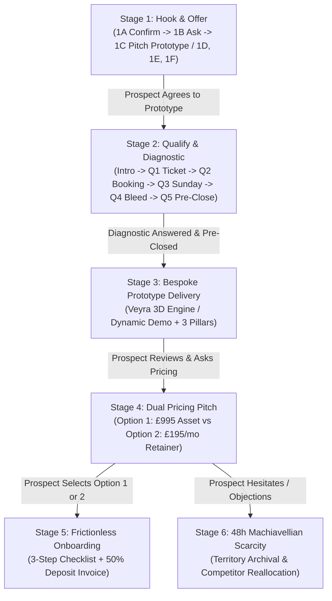

# 🏛️ Mercian Wealth — High-Ticket Acquisition Playbook & Outreach Engine

**System:** Admin Outreach Cockpit & Consultative Client Acquisition Pipeline  
**Target:** Local Trade Contractors, Luxury Bespoke Jewellers / Diamond Ateliers, Private Clinics, High-End Service Businesses  
**Path:** `components/admin/outreach-modal.tsx`  
**Status:** Active & Production Ready  

---

## 1. Executive Summary & Strategic Architecture

The **Mercian Wealth High-Ticket Acquisition Engine** is a high-status, consultative sales architecture designed to transition cold or inbound local business leads into high-margin clients without sounding like a transactional web designer or software vendor.

### Core Sales Axioms
1. **Sell the Outcome, Never the Tool:**  
   Never mention code, React, Next.js, WordPress, or design plugins. Talk exclusively about **speed-to-lead**, **capturing evening mobile searches**, **eliminating no-shows via holding deposits**, and **stopping leads leaking to competitors**.
2. **The Unit Economics Anchor:**  
   Always demonstrate that **1 single customer order/job** completely pays off the entire build fee. Everything after that is pure profit.
3. **Qualify Before Delivering:**  
   *Never deliver the prototype before running the diagnostic.* When a prospect agrees to see a prototype, execute the 2-minute diagnostic first. This anchors their ticket economics, quantifies their monthly bleed, and gets them to pre-close themselves before they ever see the link or price tag.
4. **Dual Commercial Paths:**  
   Give every prospect the choice between **Complete Asset Ownership** (£995 one-off) and a **Fully Managed Retainer** (£495 setup + £195/mo rolling).
5. **Machiavellian Territory Scarcity:**  
   If a prospect hesitates or passes, never chase. Calmly introduce the 48-hour territory expiration rule: the prototype is archived and the city catchment slot is reallocated to their nearest competitor.

---

## 2. Chronological Pipeline Stages

---

## 3. Detailed Stage Specifications & Scripts

### Stage 1: Hook & Offer
Designed to initiate natural engagement without triggering spam defences.

- **1A. Confirm Name:**  
  `Hi 👋, is this [BUSINESS_NAME]?`
- **1B. Ask For Storefront:**  
  `Great, thanks! Came across [BUSINESS_NAME] — love your work. Do you have a website or storefront I could look at where you showcase your [CORE_OFFERING]?`
- **1C. Pitch Prototype (Dynamic Replies):**  
  - *General "No Website":* Explains that reputation exists, but evening phone searchers have nowhere to browse or commit. Offers free mobile working prototype.
  - *Linktree / Instagram Reply:* Addresses friction in browsing social feeds vs. instant certified specifications and consultation bookings.
  - *Password-Locked Reply:* Highlights that evening searchers bounce immediately from locked screens to competitors.
- **Situational Direct Hooks:**  
  - **1D. Outdated Site Hook:** Tailored observation (slow on mobile, broken layout).
  - **1E. Linktree / Social-Only Hook:** Immediate hook for accounts relying solely on bio links.
  - **1F. Password-Locked Store Hook:** Immediate hook for Shopify/storefronts sitting behind password gates.

---

### Stage 2: Qualify & Revenue Leakage Diagnostic
*Executed immediately when prospect says "Yes, send it over" or "Put one together".*

- **Diagnostic Hook:**  
  `Brilliant. Before I put it together on my end — I don't build generic cookie-cutter templates. I engineer each system specifically around the exact customer journey and economics of [BUSINESS_NAME]. Quick 2-minute diagnostic so I get the prototype 100% dialled in for you:`
- **Q1 (High-Ticket Focus & Ticket Value Anchor):**  
  `What's your primary high-ticket focus right now — is it bespoke commissions / engagement rings, or finished showroom stock? And roughly what is an average commission/order worth to you in gross revenue?`
- **Q2 (Booking & Commitment Model):**  
  `When a client wants to discuss a bespoke piece / project, do they currently just send a DM or drop in, or do you have a dedicated private showroom consultation booking where they can secure their slot or pay a holding deposit?`
- **Q3 (Sunday Evening Reality):**  
  `Right now, over 75% of high-intent searches in [CITY] happen on smartphones in the evening or on weekends when [the showroom is closed / you're off the tools]. When someone discovers [BUSINESS_NAME] on Sunday at 9 PM, what actually happens? Can they explore your work, build confidence, and lock in a consultation, or do they bounce to whoever answers online first?`
- **Q4 (Quantifying Monthly Bleed):**  
  `Realistically, how many potential high-ticket enquiries or clients do you think slip through the cracks each month simply because there's no fast digital storefront capturing them outside working hours?`  
  *(Calculates: [Missed Enquiries] × [Ticket Value] = £[Monthly Bleed] / £[Annual Bleed]).*
- **Q5 (The 1-Job Payoff Pre-Close):**  
  `So if having this dedicated system captures literally ONE single customer over the next 90 days that would have otherwise gone to a competitor — that completely pays off the entire project, and everything after that is pure profit, right?`

---

### Stage 3: Bespoke Prototype Delivery
Delivered once the diagnostic answers have been received and incorporated.

- Points to either the **Veyra 3D Diamond/Jewellery Engine** (`https://veyra-premium-3-d-jewellery-e-comme.vercel.app/?client=[BUSINESS_NAME]`) or the dynamic local demo preview.
- Anchors the 3 pillars:
  1. **Captures Evening & Mobile Traffic:** Over 75% of local searches happen outside operating hours.
  2. **Direct Action & Deposit Locks:** Customers schedule appointments or lock pieces with holding deposits.
  3. **Sub-Second Speed:** Loads in under 400ms on 4G/5G mobile phones.

---

### Stage 4: Dual-Pathway Commercial Pitch
Presented when prospect asks for rates or how implementation works.

#### Option 1: Complete Asset Ownership (One-Off Investment)
- **Build Fee:** £995 one-off (or £495 for Essential 3-page builds)
- **Payment Terms:** 50% deposit (£497.50) upfront; 50% only on completion & 100% satisfaction.
- **Ownership:** 100% code, domain, and data ownership. Zero ongoing agency fees.
- **Running Fees:** Self-managed or £12/month (£120/year) for managed edge cloud + SSL.
- **Unit Economics Anchor:** 1 order completely covers the build fee.

#### Option 2: Fully Managed Growth Retainer (100% Hands-Off)
- **Setup Fee:** £495 setup
- **Retainer:** £195/month (rolling, cancel anytime)
- **Included:** Domain renewals, hosting, security updates, unlimited WhatsApp updates within 24h, Google local SEO optimization.

---

### Stage 5: Frictionless 3-Step Onboarding
Eliminates onboarding resistance with a simple 3-part WhatsApp checklist:
1. **Initial Content:** 6–10 photos of best pieces/jobs with prices & descriptions.
2. **Notifications:** Email & mobile phone for booking and quote alerts.
3. **Payouts:** Business bank details or Stripe account for direct customer deposits.
- Automatically triggers the 50% deposit invoice (£497.50).

---

### Stage 6: 48-Hour Machiavellian Territory Scarcity
Issued only if prospect hesitates, stalls, or says "Can't afford it":
- Acknowledges their position respectfully.
- Restates the commercial reality of Sunday evening mobile search bleed in their city.
- Enforces 48-hour prototype lifespan before the demo is archived and the catchment slot is awarded to their local competitor to prevent competing systems in the same territory.

---

### Tab 7: 15-Second Voice Note Prompter
For rapid personal voice note delivery on WhatsApp:
- Uses tailored, high-status language ("between showroom clients" or "with a spare minute" rather than generic contractor jargon like "off the tools" for luxury jewellers).
- Delivers the hook and prototype link in under 15 seconds.

---

## 4. Mobile Responsiveness & Touch Architecture

To ensure flawless usability on mobile smartphones and tablets:
1. **Swipeable Tab Navigation:**  
   Replaced fixed 7-column grid with `flex items-center gap-1.5 overflow-x-auto scrollbar-none sm:grid sm:grid-cols-7 sm:overflow-visible`. Each stage button has minimum touch-safe widths (`min-w-[76px]` to `min-w-[88px]`) preventing text clipping.
2. **Horizontal Sub-Selector Strips:**  
   Sub-step buttons (1A–1F, Q1–Q5, Pricing Options) utilize horizontal scroll with `shrink-0 sm:shrink-initial whitespace-nowrap`, preserving clean lines without multi-line button jitter.
3. **Adaptive Action Bars:**  
   Copy, Call, and Send via WhatsApp buttons feature `flex-wrap` and full touch accessibility.
4. **State Isolation:**  
   Modal state dynamically resets on `lead.id` switch to prevent text or stage bleeding between prospects.

---

## 5. Verification Checklist

- [x] TypeScript clean check: `npx tsc --noEmit` passes with 0 errors.
- [x] Production build check: `npm run build` succeeds without regressions.
- [x] Chronological tab ordering verified: Hook (1) -> Qualify (2) -> Prototype (3) -> Pricing (4) -> Onboard (5) -> Scarcity (6) -> Voice (7).
- [x] Dynamic variable substitution verified for Diamond Ateliers, High-End Jewellers, Trade Contractors, Clinics, and Services.
- [x] Full mobile responsive scroll verified across all viewports.
