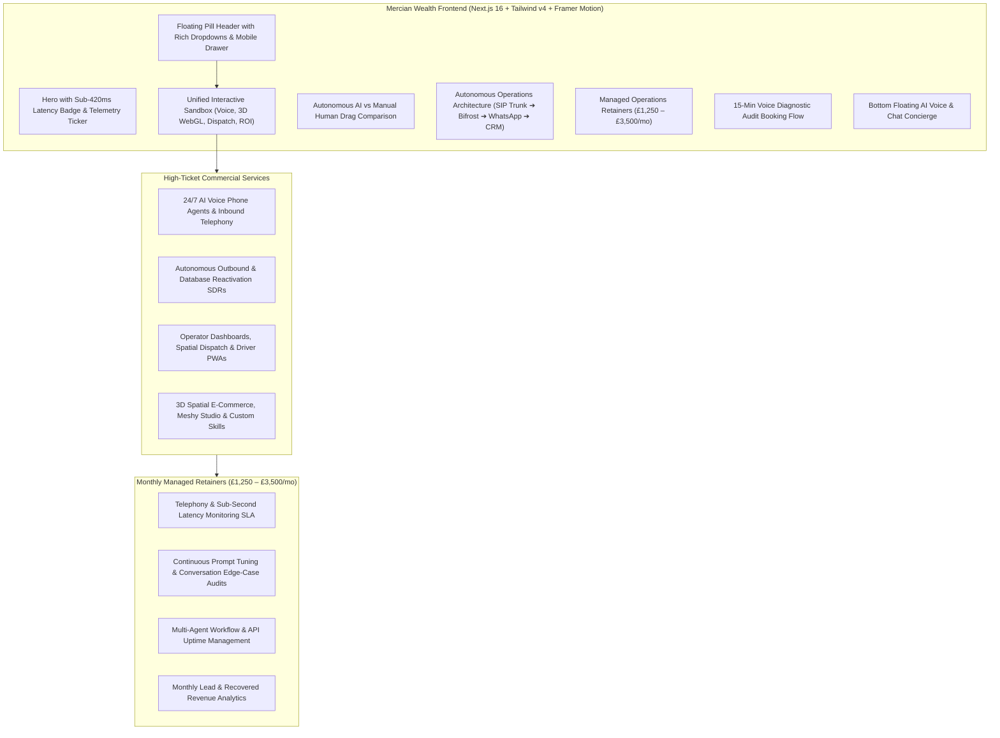

# Implementation Plan: AI Voice, Dispatch & Retainer Agency Transformation

## Executive Summary & Strategic Objective
Transform the **Mercian Wealth** platform from a local £495 website builder into an **elite, enterprise-grade AI Voice, Telephony & Autonomous Operations Infrastructure Agency**. The platform preserves the canonical charcoal-and-gold visual identity (`#09090B`, `#111115`, `#DCAE53`) and geometric bowtie branding, while fully showcasing high-ticket AI capabilities (Inbound/Outbound Voice Callers, Subagent Workflows, Logistics Operator Dashboards, Spatial Matching, and Custom Skills) to reliably close **£1,250 – £3,500/month recurring retainers**.

---

## Key Refinements & User Feedback Addressed

### 1. Procedural 3D Asset Engine (No Spheres Bug)
* **Root Cause Identified**: Presets in `components/interactive-3d-showcase.tsx` previously used primitive subdivided polyhedrons (`IcosahedronGeometry`, `DodecahedronGeometry`, `OctahedronGeometry`) which rendered as indistinguishable dark spheres with orange specular dots.
* **Resolution**: Replaced with dedicated procedural Three.js composite models for all 4 presets:
  1. **Precision Tourbillon Watch**: Bezel ring, dial plate, hour tick markers, mechanical tourbillon assembly with rotating center gear, oscillating hands, and strap lugs.
  2. **Autonomous Spatial Lidar Drone**: Central carbon chassis, 4 diagonal motor arms, 4 rotor hubs with dual spinning propellers, Lidar sensor dome, and landing gear skids.
  3. **Mayfair Prime Penthouse Suite**: Modernist architectural glass & gold pavilion with cantilevered foundation, glass mullions, interior lighting core, and rooftop terrace pergola louvers.
  4. **Cryogenic High-Pressure Valve**: Flanged industrial pipe housing, cylindrical valve body, stem shaft, bolt rings, and 4-spoke circular handwheel.

### 2. Modern Floating Pill Navigation & Rich Dropdowns
* **Desktop**: Centered floating rounded-full glassmorphism pill (`max-w-5xl`, `bg-[#111115]/90 border border-[#DCAE53]/25 backdrop-blur-xl shadow-2xl`) with hover/click flyout cards for:
  - **AI Solutions** (Inbound Voice, Fleet Dispatch, 3D Spatial E-Com, Autonomous Outbound SDR).
  - **Sandboxes & Demos** (AI Voice Sandbox, 3D Studio, Dispatch Simulation, ROI Calculator).
* **Mobile**: Compact floating header pill (`Brand Logo` + `Book Audit` gold pill + `Mobile Hamburger`). When tapped, opens an optimized slide-down drawer with thumb-accessible taps, direct WhatsApp trigger, and categorized service links.

### 3. Mobile-First Page Architecture & Layout Streamlining
* **Unified Interactive Sandbox Switcher**: Unifies the live interactive sandboxes into an engaging mobile switcher to prevent 14,000px endless scrolling.
* **Touch-Safe 3D Controls**: `touch-action: pan-y` with explicit touch-drag interaction overlay to avoid trapping mobile page scroll gestures.
* **Mobile Retainer Cards**: Stacked cards with clear setup + monthly retainer breakdown, and expandable SLA drawer for technical comparison without broken horizontal table scrolling.

---

## Architecture & System Blueprint

---

## Verification Plan

### Automated Checks
- `npm run build`: Verify clean TypeScript compilation and Next.js static/dynamic route generation.

### Mobile & Desktop Visual Verification
1. **Interactive 3D Engine**: Confirm all 4 presets (Watch, Drone, Penthouse, Valve) render their unique composite geometries instead of generic spheres.
2. **Floating Pill Header**: Test hover dropdown flyouts on desktop and mobile drawer toggle on mobile viewports (375px–430px).
3. **Touch-Safe Scrolling**: Verify page scrolls vertically without getting stuck on 3D canvas or sliders.
4. **Pricing Responsive Cards**: Check that mobile screens display clear stacked retainer cards and cleanly formatted SLA checklists.
