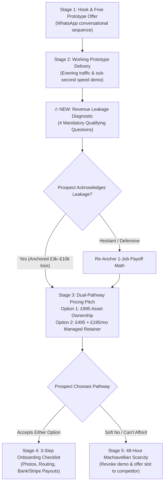

# Implementation Plan: Client Acquisition Playbook & Revenue Leakage Diagnostic Engine

## 1. Problem Diagnosis & Strategic Context

### The Sales Breakdown (Why Prospects Were Dropping at Price)
On previous calls, prospects were engaged during prototype walkthroughs, asked about timelines and features, but backed away the moment pricing was stated (£1,495 or £995 + £100/mo). 

**The Root Cause:**
The call was structured as a **product/design showcase** rather than a **financial investment diagnosis**. 
* The prospect was never asked to quantify their numbers (average customer value, cost of missed evening traffic, lost weekend enquiries).
* When the price was introduced at the end, the prospect evaluated £995 or £1,495 against **£0 (their current cost of doing nothing)**.
* **The Solution:** We must insert a mandatory **Revenue Leakage Diagnostic** into the workflow *before* pricing is ever revealed. When the business owner states with their own mouth that one lost customer is worth **£3,000 – £8,000**, an investment of **£995** transforms from an expense into an indisputable 300%–800% ROI.

---

## 2. Architecture & Workflow

---

## 3. The 4-Question Revenue Leakage Qualifying Framework

These qualifying questions will be embedded into the **Outreach Cockpit** as a guided script for Gurtej to run before presenting pricing:

1. **Question 1: The Average Ticket Anchor**
   > *"Before we talk about the build, just to understand the economics of your business — roughly what is an average [bespoke commission / roofing project / aesthetic treatment] worth to you in revenue or gross margin?"*
   * *Target Response:* "Around £1,500 – £4,000" (or £5,000+ for contractors/jewellers).

2. **Question 2: The Sunday Evening Traffic Reality**
   > *"Right now, over 75% of high-intent searches in [City] happen on smartphones in the evening or on weekends when you're off the tools / shop is closed. When someone discovers [Business Name] on Sunday at 9 PM, what actually happens? Can they explore your work and lock in a consultation, or do they bounce to whoever answers online first?"*
   * *Target Response:* "They probably bounce / message someone else / wait until Monday."

3. **Question 3: Quantifying The Monthly Bleed**
   > *"Realistically, how many potential high-ticket enquiries do you think slip through the cracks each month simply because there's no fast digital storefront capturing them outside working hours?"*
   * *Target Response:* "Probably at least 2 or 3 a month."
   * *The Math Anchor:* 2 missed jobs $\times$ £2,500 = **£5,000/month (£60,000/year) in leaking revenue.**

4. **Question 4: The 1-Job Payoff Pre-Close**
   > *"So if having this dedicated system captures literally ONE single customer over the next 90 days that would have otherwise gone to a competitor — that completely pays off the entire project, and everything after that is pure profit, right?"*
   * *Target Response:* "Yeah, absolutely."
   * *Result:* The prospect has just pre-closed themselves before seeing the price tag.

---

## 4. Proposed Changes Across the System

### Component 1: Admin Outreach Cockpit Modal
**File:** `components/admin/outreach-modal.tsx`

* **Restructure Tabs into the Exact 6-Stage Playbook:**
  1. `1. Hook & Offer` (`stage1`) — Conversational multi-message sequence (1A Name Confirm $\rightarrow$ 1B Core Hook & Free Prototype Offer).
  2. `2. Send Prototype` (`stage2`) — Live URL delivery highlighting Evening Mobile Traffic, Direct Action & Deposit Locks, Sub-Second Speed.
  3. `3. Qualify & Leakage` (`qualify` **[NEW]**) — The 4-Question Financial Leakage Diagnostic Script with interactive calculators for Average Job Value $\times$ Missed Enquiries.
  4. `4. Dual Pricing` (`stage3`) — Option 1 (£995 one-off Asset Ownership) vs Option 2 (£495 setup + £195/mo Managed Retainer) with "1-to-2 Job Payoff" Commercial Math.
  5. `5. Onboarding` (`stage4`) — The 3-item checklist (Photos/content, notification channels, bank/stripe payout setup).
  6. `6. 48h Scarcity` (`stage5`) — The Machiavellian Loss-Aversion Response (archiving prototype in 48h and releasing the catchment slot to a local competitor).
  7. `🎙️ Voice Note` (`voice`) — 15-second natural spoken prompter.

---

### Component 2: Local & Public Pricing Alignments (No Breaking Changes)
**File:** `components/local/local-pricing.tsx` & `Implementation/General/MERCIAN_WEALTH_CLIENT_ACQUISITION_PLAYBOOK.md`

* **Align Local Pricing Tiers with Dual Commercial Pathways:**
  * **Option 1: Complete Asset Ownership (One-Off Capital Asset)**
    * **Build Fee:** £995 one-off (or £495 for Essential 3-page builds).
    * **Terms:** 50% initial deposit (£497.50), remaining 50% on live launch and 100% satisfaction.
    * **Ownership:** 100% asset ownership (code, domain, customer data).
    * **Optional Running Fee:** £12/month (or £120/year) if Mercian hosts and maintains edge servers/SSL.
  * **Option 2: Fully Managed Growth Retainer (100% Hands-Off)**
    * **Setup Fee:** £495 setup.
    * **Retainer:** £195/month rolling (cancel anytime).
    * **Included:** Hosting, SSL, domain renewals, unlimited WhatsApp stock/content updates within 24h, pricing adjustments, continuous local Google ranking.
* **Embed the "Commercial Math" Interactive Callout:**
  * Displays a prominent guarantee badge: *"Securing just 1 or 2 new client orders pays for the entire build. Everything after is pure profit."*

---

## 5. Verification Plan

### Manual Verification
1. **Outreach Cockpit Navigation:**
   * Open `/admin/leads`, select any lead, and verify all 6 tabs load seamlessly.
   * Verify dynamic variable substitution: `[BUSINESS_NAME]`, `[CITY]`, `[CORE_OFFERING]`, `[THE_MATH]` adapt automatically based on trade (Jeweller vs Builder vs Clinic).
   * Test WhatsApp direct launch: Click **Send via WhatsApp** on each tab and verify pre-filled text formatting.
2. **Pricing Transparency Check:**
   * Verify pricing values on the local storefront section match the £995 Asset vs £195/mo Retainer structure.
   * Verify zero regressions on main site and Next.js Turbopack build.
