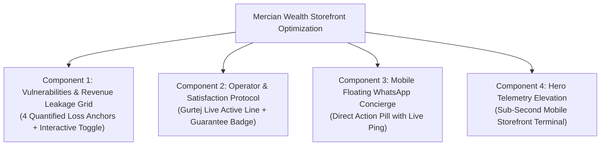

# Competitor Benchmark & Conversion Engine Implementation Plan
**Target Benchmark:** SwiftScale (`swiftscaled.com`)  
**Product:** Mercian Wealth (`mercianwealth.com`)  
**Objective:** Elevate Mercian Wealth's storefront architecture, mobile conversion mechanics, loss-aversion diagnostics, and operator trust seals to outperform direct competitors while maintaining our signature Obsidian & Gold luxury fintech standard.

---

## 1. Competitive Strategic Diagnosis

### SwiftScale (`swiftscaled.com`) Deconstruction
* **Aesthetic Strengths:** High-contrast cyberpunk/military HUD, intense visual hierarchy, live telemetry readouts, 3D tilt effects, tactical scanlines.
* **Conversion Strengths:**
  1. *System Vulnerabilities Diagnostic Report:* Quantifies losses (42% lost to latency, 60% abandon after 10 min, 30% payroll on repetitive tasks).
  2. *Execution Protocol (01 Recon → 02 Build → 03 Deploy):* Removes friction about what happens after paying.
  3. *The Operator / Founder Directive:* Founder face + live `ONLINE` pulse indicator + personal directive.
  4. *Satisfaction Protocol:* Unlimited revisions + response within 24 hours.
* **Competitor Fatal Flaws:**
  1. *Gamer/Skynet Theme:* Alienates serious UK jewellers, luxury builders, Harley Street clinics, and high-ticket service firms.
  2. *Broken Metrics in Live Code:* Static `0%`, `0.0%`, `0M+`, `0/7` renders broken counters, killing credibility.
  3. *High Upfront Wall:* $2,500 – $8,500 commitment before seeing any customized work.
  4. *Geographic Distance:* Based in Tripoli, Libya (`+218`), introducing contract and jurisdictional hesitancy for UK/EU businesses.

---

## 2. Mercian Wealth Elevation Architecture

---

## 3. Detailed Component Implementation Specs

### Component 1: System Vulnerabilities & Revenue Leakage (`components/bottleneck.tsx`)
* **Goal:** Force the prospect to confront their actual revenue leakage with concrete commercial data before seeing pricing.
* **4 Concrete Diagnostic Metrics:**
  1. **Latency Abandonment (42% Lost):** 42% of high-intent local customer enquiries are lost due to response latency exceeding 10 minutes.
  2. **The Sunday Night Bleed (75% Mobile Searches):** Over 75% of local searches happen outside working hours on mobile phones when businesses are closed or off the tools.
  3. **No-Show Revenue Destruction (£3,000+ Annual Loss):** Over £3,000+ lost annually to uncommitted appointments that fail to collect upfront card deposits.
  4. **Mobile Loading Friction (53% Bounce Rate):** Every 1-second delay in page load drops mobile conversion by 20%, handing leads to competitors.
* **Design:**
  * Obsidian & Gold bordered cards with metric callouts, interactive hover glow, and mobile-optimized touch responsiveness.

### Component 2: Founder & Operator Commitment with Live Line (`components/why-mercian-wealth.tsx`)
* **Goal:** Elevate operator trust to institutional standards with personal accountability.
* **Key Additions:**
  1. **Live Direct Line Status Badge:**
     * `🟢 FOUNDER DIRECT LINE ACTIVE` with pulsing emerald indicator.
  2. **Satisfaction Protocol:**
     * *Unlimited revisions until 100% satisfied.*
     * *Every system personally reviewed and launched by the founder.*
     * *Response to every transmission/message within 24 hours.*
  3. **1-Tap Direct WhatsApp Action Button:**
     * Connect directly with Gurtej on WhatsApp.

### Component 3: Mobile-First Floating Concierge (`components/floating-ai-concierge.tsx` & Mobile WhatsApp Pill)
* **Goal:** Give mobile visitors an effortless, persistent, non-intrusive action channel to message Gurtej or test the prototype.
* **Design:**
  * Mobile-visible luxury gold floating action pill: `🟢 Chat on WhatsApp · <15 min reply`
  * Fully responsive, sticky to bottom right, carefully padded so it doesn't obstruct form inputs or navigation.

---

## 4. Mobile Responsiveness & Layout Verification
* Touch targets $\ge 44\text{px}$ across all interactive buttons.
* Safe padding and spacing avoiding horizontal scroll (`overflow-x-hidden`).
* Typography hierarchy tuned for 375px – 430px smartphone viewports (iPhone SE through iPhone 16 Pro Max).
* Zero layout shifts (CLS) on dynamic animations.

---

## 5. Verification & Quality Assurance Plan
1. **TypeScript Verification:** `npx tsc --noEmit` must return 0 errors.
2. **Next.js Turbopack Production Build:** `npm run build` must succeed with exit code 0.
3. **Responsive Mobile Audit:** Verify clean viewport rendering across all breakpoints.
