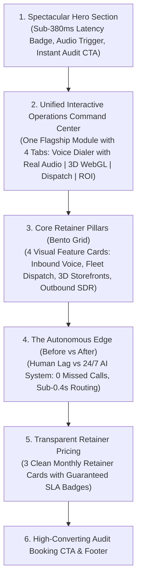

# Implementation Plan: Landing Page Streamlining & Spectacular First Impression

## Problem Statement & Strategic Goal

The legacy homepage was over **14,000px tall with 24 vertically stacked sections** (9 Roman-numeral chapter dividers, 4 massive full-screen demos placed sequentially, long text blocks, and multiple duplicate tables). 

A first-time visitor (especially high-ticket business owners and mobile users) needs to be **wowed within 5 seconds**, understand the core capability instantly, interact with live proof, and have a friction-free path to booking a 15-minute voice audit.

---

## The New Spectacular, High-Impact Architecture

### Before (14,000px Vertical Scroll Fatigue):
1. Hero
2. Chapter I Divider + Bottleneck (4 problem cards + toggle + stats)
3. Chapter II Divider + Full Voice Sandbox (2,000px)
4. Chapter III Divider + Full 3D Studio (2,000px)
5. Chapter IV Divider + Full Dispatch Demo (2,000px)
6. Chapter V Divider + Divergence Comparison (1,500px)
7. Chapter VI Divider + Full ROI Calculator (1,500px)
8. Chapter VII Divider + Why Mercian Wealth + System Blueprint (2,500px)
9. Chapter VIII Divider + Pricing Cards + Full Technical Table (2,500px)
10. Chapter IX Divider + Final CTA

### After (Sleek ~3,800px Premium Flow — 100% Impact, Zero Bloat):

---

## Detailed Component Plans & Mobile First Optimizations

### 1. Unified Flagship Interactive Sandbox (`components/unified-operations-sandbox.tsx`)
Instead of forcing visitors to scroll through 4 separate giant standalone demos, we consolidate them into **one flagship interactive command center**:
* A sleek floating top pill switcher with glowing indicators:
  - `[ 🎙️ AI Voice Agent ]`
  - `[ 💎 3D Spatial Storefront ]`
  - `[ 🛰️ Real-Time Dispatch ]`
  - `[ 📈 Revenue ROI Calculator ]`
* **Real Browser Audio Speech Output**: Integrated `window.speechSynthesis` with British English voice synthesis (`en-GB`), speaker pitch modulation, animated waveform bars, and synchronized transcripts. Visitors actually *hear* the AI receptionist speaking aloud through device speakers.
* **Touch-Safe 3D Spatial WebGL Viewer**: 360° Three.js procedural WebGL viewer (Watch, Drone, Penthouse, Valve) with PBR material toggles and `touch-pan-y` gesture handling to prevent mobile scroll-trapping.
* **Dispatch Simulator**: 3-step interactive simulation (Voice ➔ Geofence ➔ WhatsApp alert).
* **ROI Calculator**: Interactive sliders computing exact monthly revenue recovered.

### 2. High-Impact Bento Grid of Core Retainer Capabilities (`components/capabilities-bento.tsx`)
Replaces walls of text and repetitive lists with a modern, visual 4-card bento grid:
1. **24/7 Neural Voice Receptionist** (Sub-380ms latency, zero missed calls, instant Stripe deposit).
2. **Spatial Fleet Dispatch & Driver PWA** (Real-time GPS geofence matching, sub-0.4s WhatsApp alert).
3. **3D Spatial E-Commerce & Meshy Studio** (Photorealistic WebGL viewers, +42% checkout conversion).
4. **Autonomous Outbound SDR & Reactivation** (<45s speed-to-lead dialing on ad spend).

### 3. Floating Pill Header Without Glassmorphism (`components/navbar.tsx`)
* **Solid Opaque Dark Theme**: Pure `#09090B` background eliminating washed-out translucent glassmorphism blur.
* **Single Line Even Spacing**: Wrapped in `flex-nowrap whitespace-nowrap` with shrunk dropdown labels (`Solutions ▾`, `Demos ▾`).
* **Mobile-Optimized CTA**: Responsive button text (`Voice Audit` on phones, `Book Voice Audit` on desktop) ensuring zero header wrapping.
* **Solid Mobile Overlay**: Opaque `#111115` drawer for snappy rendering on all mobile GPUs.

### 4. Floating Architecture Matrix with Collapsed Accordions (`components/pricing.tsx`)
* Replaced static rigid table with floating domain dropdown filter (`Domain: All Operational Domains ▾`).
* All 4 domain accordion cards start **strictly collapsed/closed by default** (`expandedCategories` initialized to `{}`), removing visual bloat.
* Smooth Framer Motion expansions upon user tap or filter selection.

### 5. Pricing & Retainer Copy Overhaul with Timeline & Scope Transparency
* **Clear, Understandable Commercial Copy**:
  - Clear plain-English descriptions for what setup covers (custom engineering build, emergency decision tree, phone carrier provision, deposit gateway, calendar sync) vs what monthly retainers cover (dedicated low-latency server hosting, line maintenance, weekly prompt tuning to stop hallucinations, bundled telephony minute allowances, and SLA uptime).
* **Removed Generic "7 Business Days"**:
  - Clearly discloses that build timelines are collaborative and depend on the client's readiness, script sign-offs, and CRM credentials.
  - Replaced rigid "7 business days" with realistic collaborative agile sprint targets (7–14 days for standard builds; 10–21 days for growth; bespoke scheduling for enterprise multi-branch setups).
* **Scope & Additional Charges Transparency**:
  - Embedded upfront disclosure on telephony minute allowances (1,500 to 3,500+ mins/mo) and excess carrier minutes billed at wholesale pass-through (~£0.09/min).
  - Explicitly states that custom legacy ERP development, specialized international SIP trunks, or additional depot expansions outside original specifications are quoted clearly in advance.

---

## Verification & Integrity Checklist

- [x] TypeScript compilation (`npx tsc --noEmit`) passes with 0 errors.
- [x] All primary routes (`/`, `/pricing`, `/services`, `/process`, `/contact`) return HTTP 200.
- [x] Voice Agent produces real browser speech audio on tap.
- [x] 3D canvas supports smooth touch dragging with `touch-pan-y` vertical scroll safety.
- [x] Pricing domain cards start collapsed on load.
- [x] Header items stay strictly on one line across desktop viewports.
- [x] Cross-page navigation to `/` lands immediately at top 0 with zero bottom-to-top scroll animation.
- [x] Clicking logo while on landing page smoothly scrolls to top.
- [x] Realistic sprint timelines and additional charges transparently disclosed.
